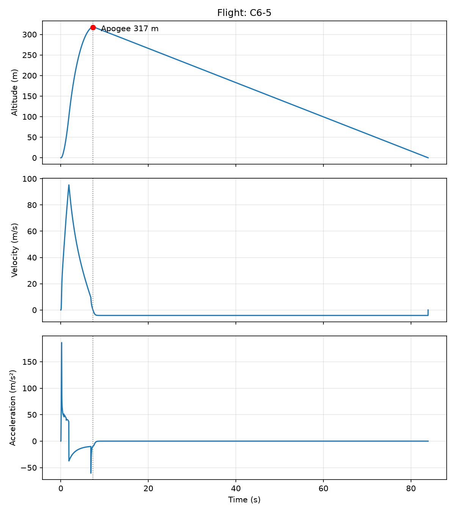
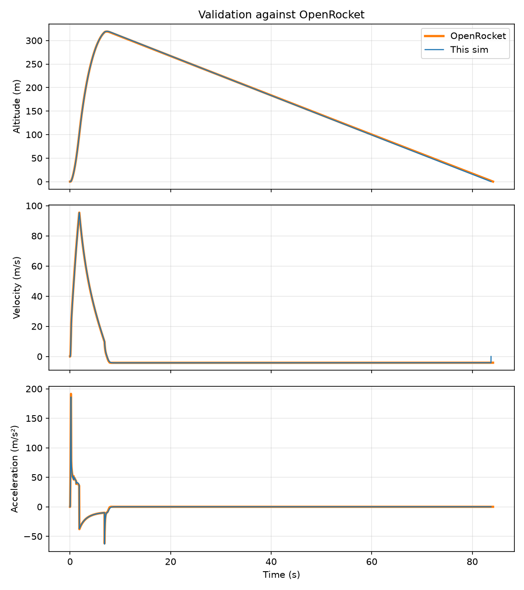
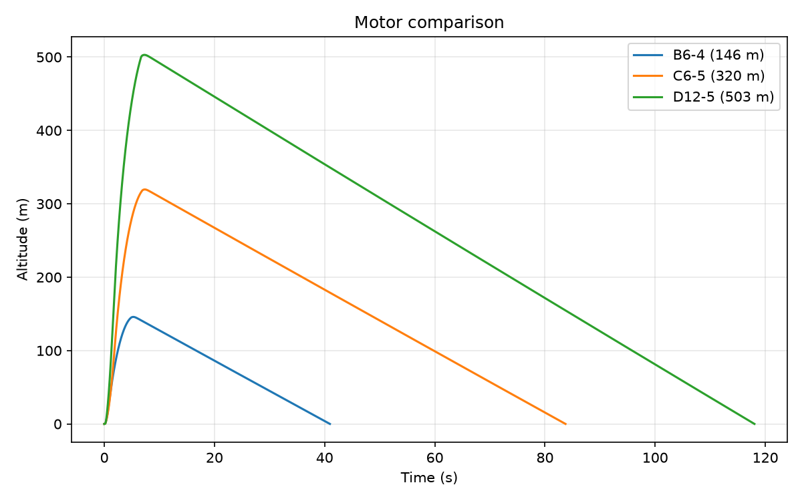
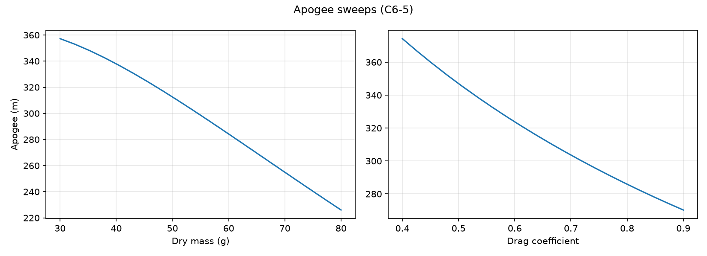

# Rocket Flight Simulator

A 1-D model rocket flight simulator in Python. It steps through a flight in small time increments using real motor thrust curves from [thrustcurve.org](https://www.thrustcurve.org), and is validated against OpenRocket.



## What it models

- Motor thrust read from real data (interpolated between data points)
- Mass loss as propellant burns (linear over the burn)
- Quadratic aerodynamic drag, always opposing motion
- Flight phases: pad, boost, coast, descent, landed
- Apogee detection and parachute deployment after the motor's delay charge
- Semi-implicit Euler integration

Assumptions: vertical flight only, no wind, constant air density (1.2 kg/m³), constant drag coefficient.

## Run it

```
pip install -r requirements.txt
python main.py
```

This prints a flight summary for each motor, saves the plots to `images/` and opens the interactive app in your browser. To open only the app, run `streamlit run app.py`.

## Interactive app

The sidebar controls every input: motor (including your own `.eng` files), ejection delay, motor masses, rocket mass, diameter and drag, parachute size and drag, launch elevation, air density, gravity, a safe landing speed and the solver time step. The app shows:

- Key numbers (apogee, max speed and acceleration, landing speed, thrust to weight, dynamic pressure) and plain-language checks on parachute timing and landing speed
- **Flight:** altitude, velocity, acceleration and thrust charts with an event table
- **Compare motors:** every motor on the same rocket, with a results table
- **Sweeps:** vary one setting and plot apogee, speed, landing speed or flight time
- **Validation:** overlay on OpenRocket data, including your own CSV
- **Data:** CSV download and the motor and rocket specifications
- **Physics:** the equations and the model's limits

## Validation against OpenRocket

The same rocket (48.2 g without motor, 24.8 mm diameter) and Estes C6-5 motor were built in OpenRocket, and its flight data exported to `data/openrocket.csv`. Drag coefficient was tuned to 0.63, since OpenRocket computes drag from separate components while this sim uses one lumped value.

| | This sim | OpenRocket |
|---|---|---|
| Apogee | 317.4 m | 319.1 m (-0.5%) |
| Flight time | 83.9 s | 84.1 s |
| Altitude error over the flight | RMS 0.9 m, max 1.8 m | |



### Time-step convergence

| dt (s) | Apogee (m) |
|---|---|
| 0.1 | 325.61 |
| 0.01 | 317.43 |
| 0.001 | 317.47 |

The result stops changing between 0.01 s and 0.001 s, so the default step of 0.01 s is accurate.

## Motor comparison and sweeps




## Files

- `main.py` — simulator, plotting and validation
- `data/` — motor thrust curves (B6, C6, D12) and the OpenRocket export
- `images/` — generated plots

## Using your own rocket or motor

Edit `ALPHA_III` in `main.py` (dry mass, diameter, Cd, chute size), or download another motor from thrustcurve.org into `data/` and load it with `load_eng` or `load_thrust_csv`. Then call `simulate(motor, rocket)`.
